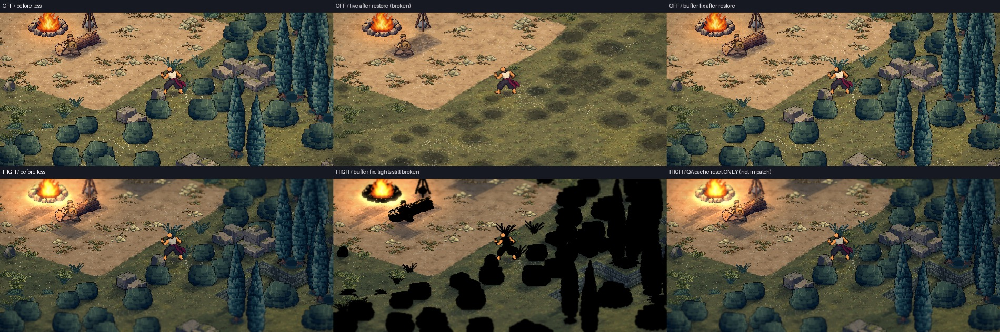
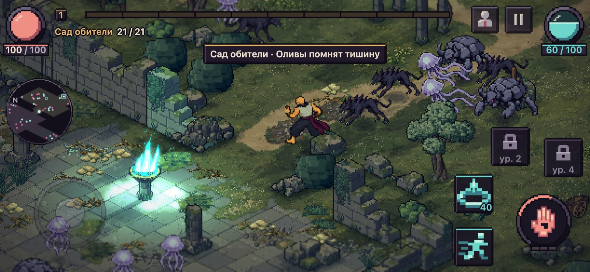
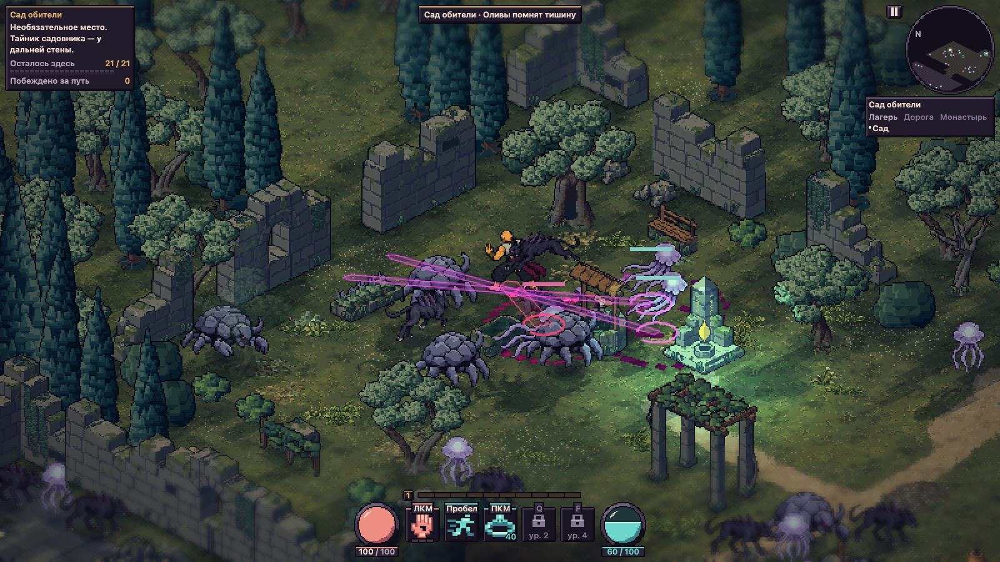

# Исправления HD-2D и стабильности — 25 октября

## Потеря контекста видеокарты
Телефон может потерять контекст видеокарты, например когда игру свернули. После восстановления часть предметов пропадала.

Верхний ряд — HD выкл:
1. Кадр до потери.
2. Старая игра после восстановления: кусты, деревья, камни и бревно пропали.
3. **С исправлением:** кадр совпадает с исходным. Это исправление уже в рабочей версии.

Нижний ряд — HD «высокий»:
1. Кадр до потери.
2. С исправлением буфера, но без исправления света: всё чёрное. Эту часть ещё делает отдельный агент.
3. Как будет после исправления света (проверочный сброс, не в коде).

## Рабочая версия после переноса рельефа и исправления
Проверка в браузере: ошибок нет, монах ходит, игра сохраняется.

