# Пилот «рисованное 2D»

Скриншоты пилота. Код пилота живёт отдельно и в игру не входит. Игра остаётся пиксельной с HD-2D, пока решение о стиле не принято.

## Оценка сходства с целью (агент-критик pt-judge)
Критик ставит кадр игры в ту же композицию, что и кадр-цель, и оценивает 10 пунктов по 10 баллов. Веса постоянные, поэтому оценки раундов можно сравнивать.

| Раунд | Сборка | Сходство |
|---|---|---:|
| 0 | фаза 2 (`ff1714f0`) | **33 / 100** |

Раунд 0, слабые места: тени 1/10, костёр 2/10, свет, плотность и персонажи по 3/10. Лучше всего — реквизит 6/10.

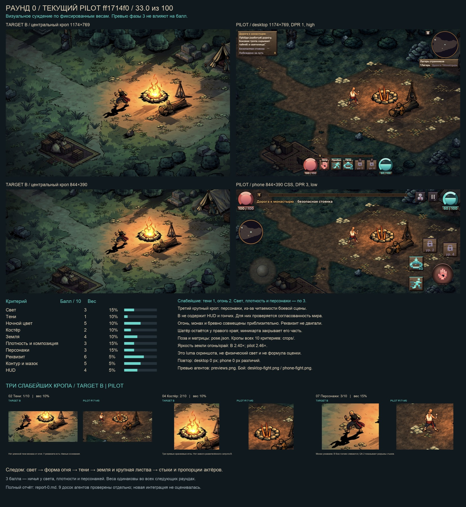

## Фаза 3 — идёт (обновлено 2026-10-25, вечер)
Цель фазы 3 — довести всю сцену до кадра-цели: свет, костёр, тени, земля, плотность. Это доски отдельных агентов. Общая сборка фазы 3 ещё не готова.

### Свет
Сверху — кадр-цель. Внизу слева — фаза 2, справа — фаза 3: тёплый круг у костра, холодная ночь вокруг. Новых проходов отрисовки нет. Костёр на этих кадрах ещё старый.

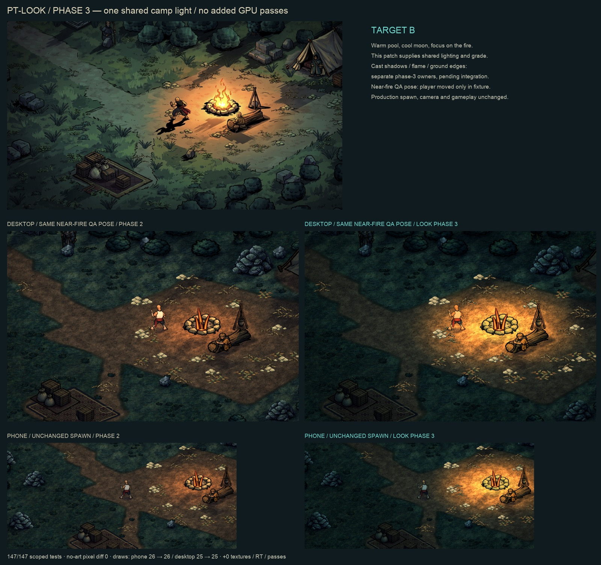

### Растения: плотность
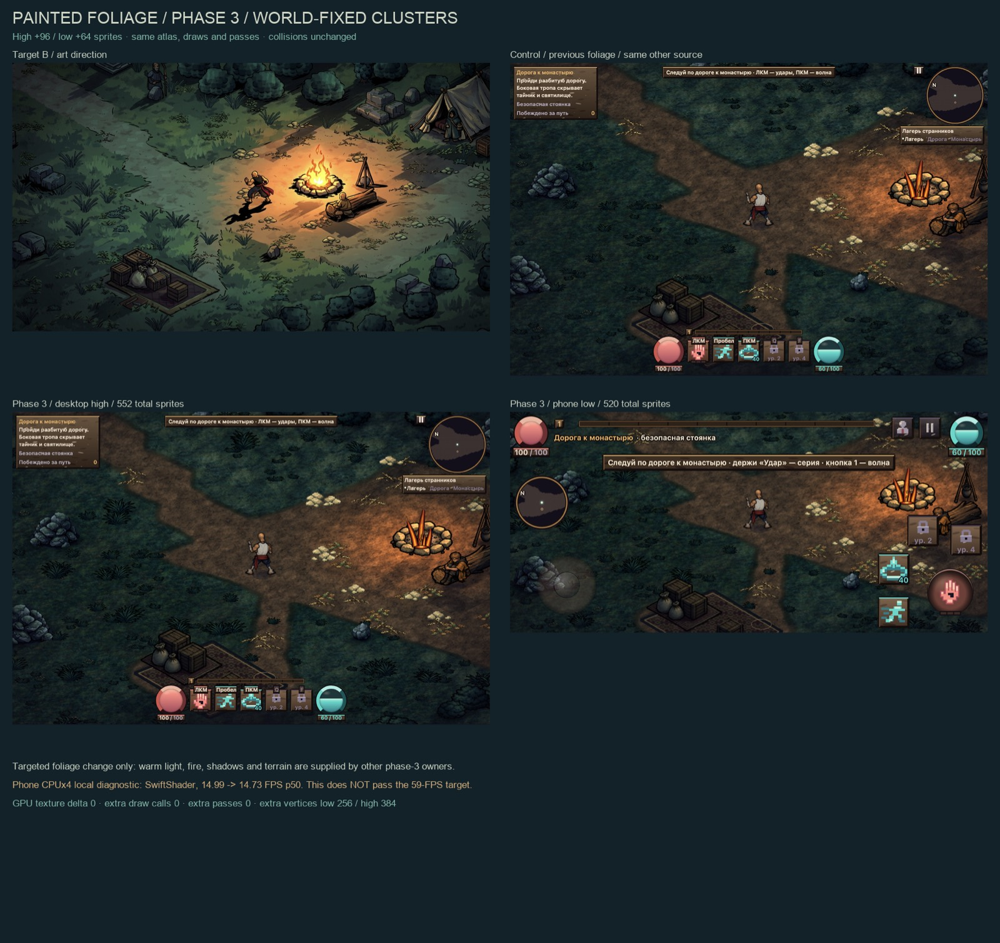

### Костёр и эффекты — черновик
Пламя на 10 кадров, искры, дым, вспышки ударов. Агент ещё работает.

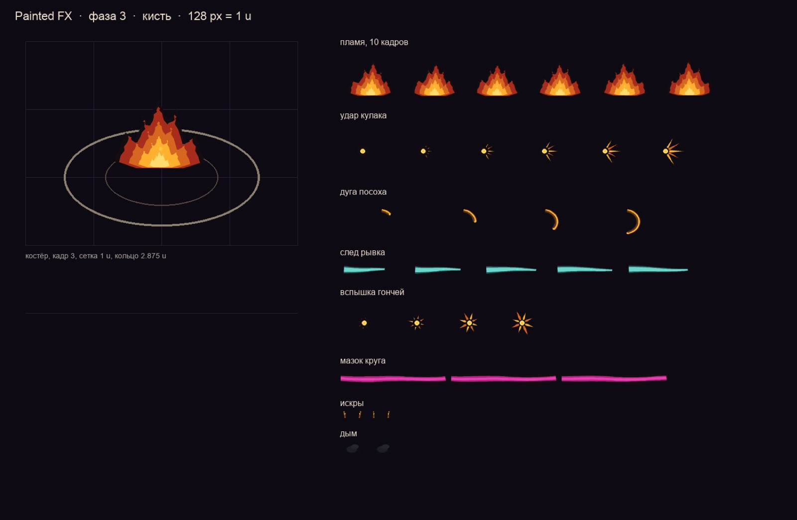

### Интерфейс
Кнопки умений без пиксельных вырезов, деревянные плашки.

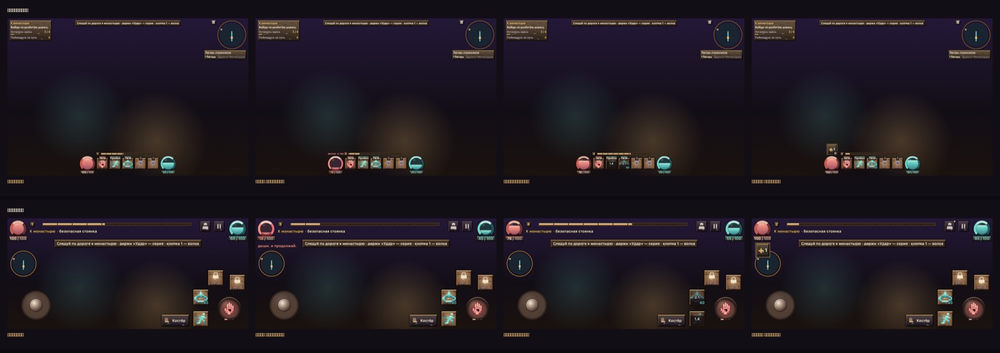

### Скорость (сборка фазы 2)
Телефон в эмуляции, CPU ×4, уровень «низкий»: 120 FPS и у пикселей, и у рисованного стиля, кадров дольше 33 мс нет.

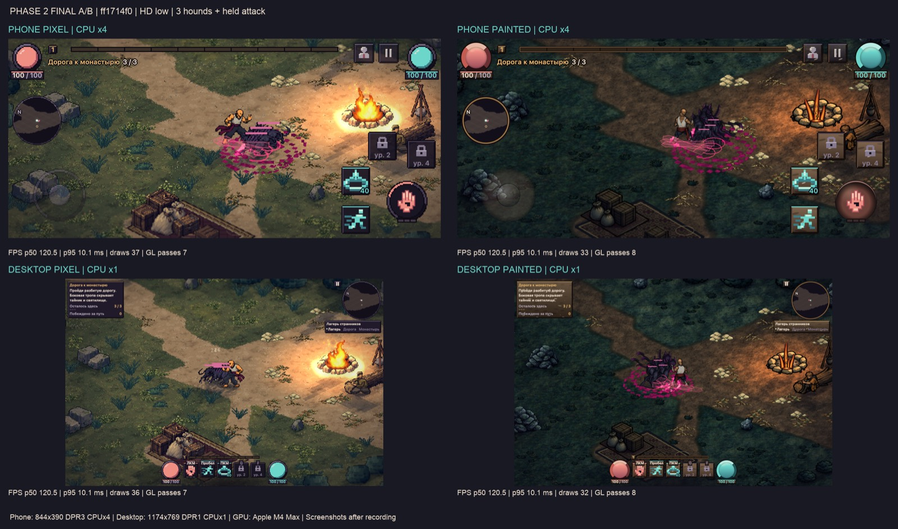

---

# Фаза 2

Сборка `ff1714f0`, 2026-10-25.

## Сборка пилота
Слева вверху — кадр-цель. Справа — фаза 1. Внизу — фаза 2: компьютер в покое и бой с тремя гончими на телефоне.

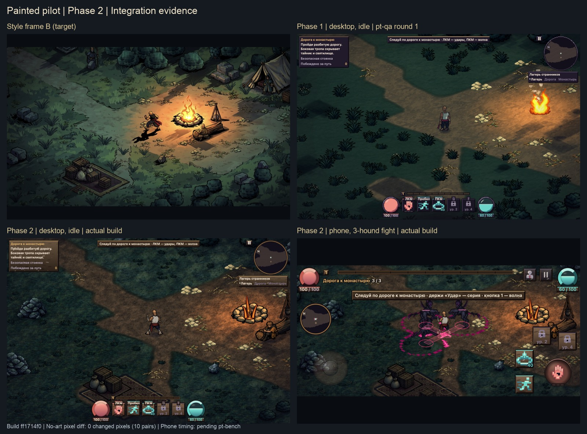

## Монах: все клипы
Покой, бег, три удара, рывок, ранение, смерть, волна. По 8 кадров на направление.

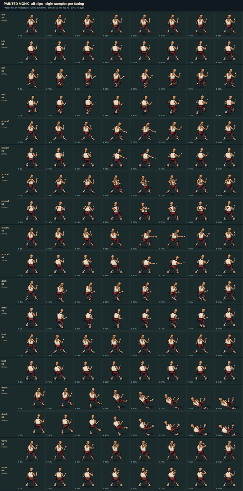

## Монах: размер
Рост как у пиксельного монаха: 1,9375 метра игры. Широкая боевая стойка.

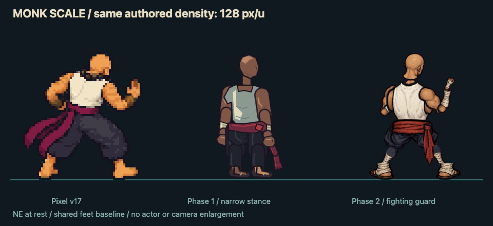

## Гончая
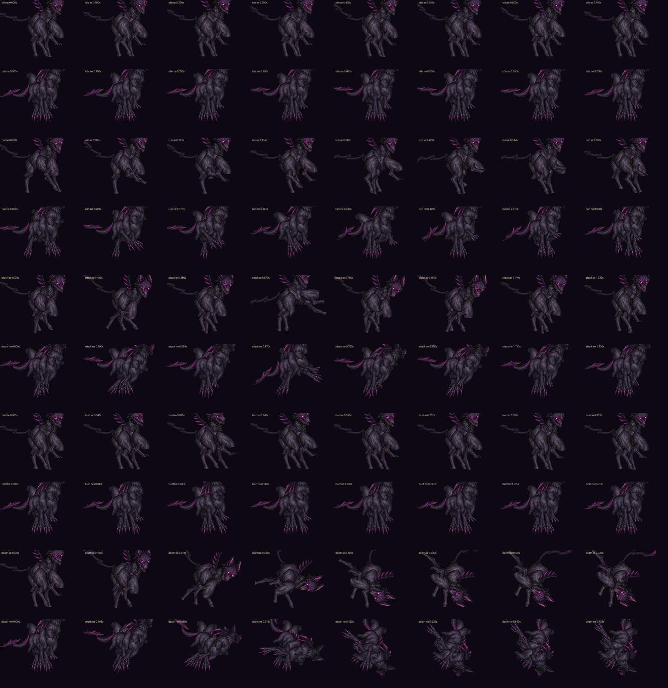

## Предметы и NPC
Реквизит лагеря. Атлас 8 МБ вместо 16.

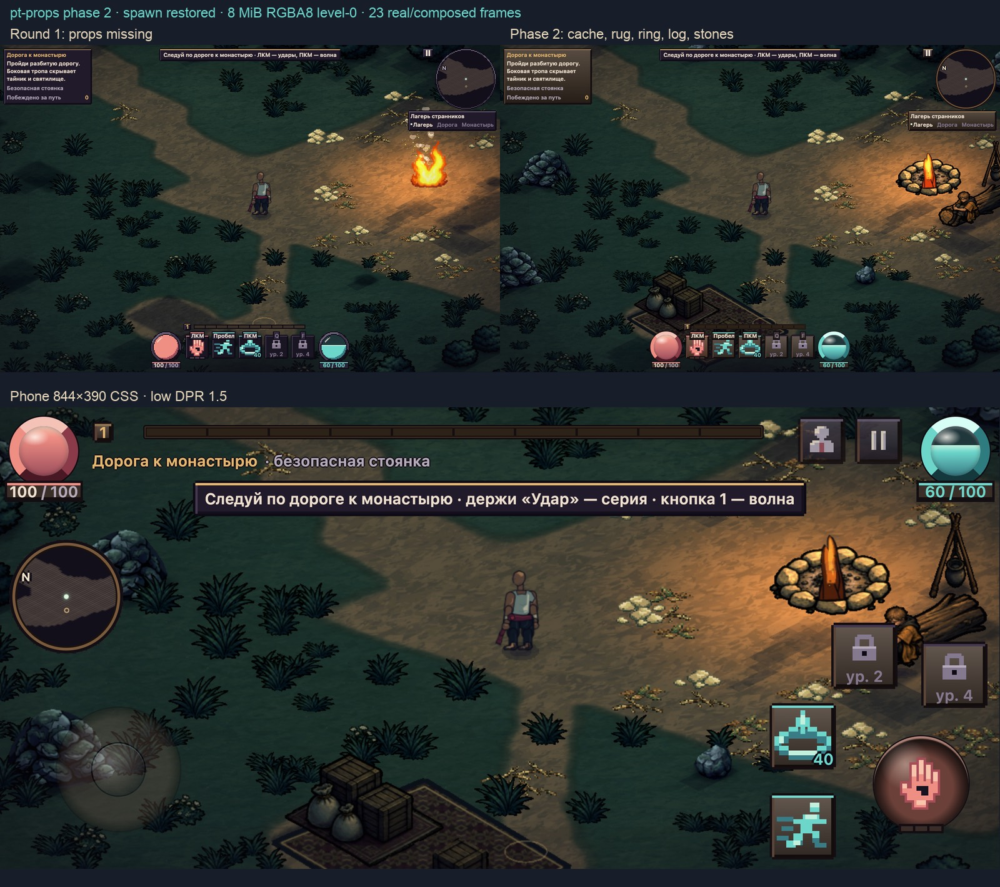

## Земля
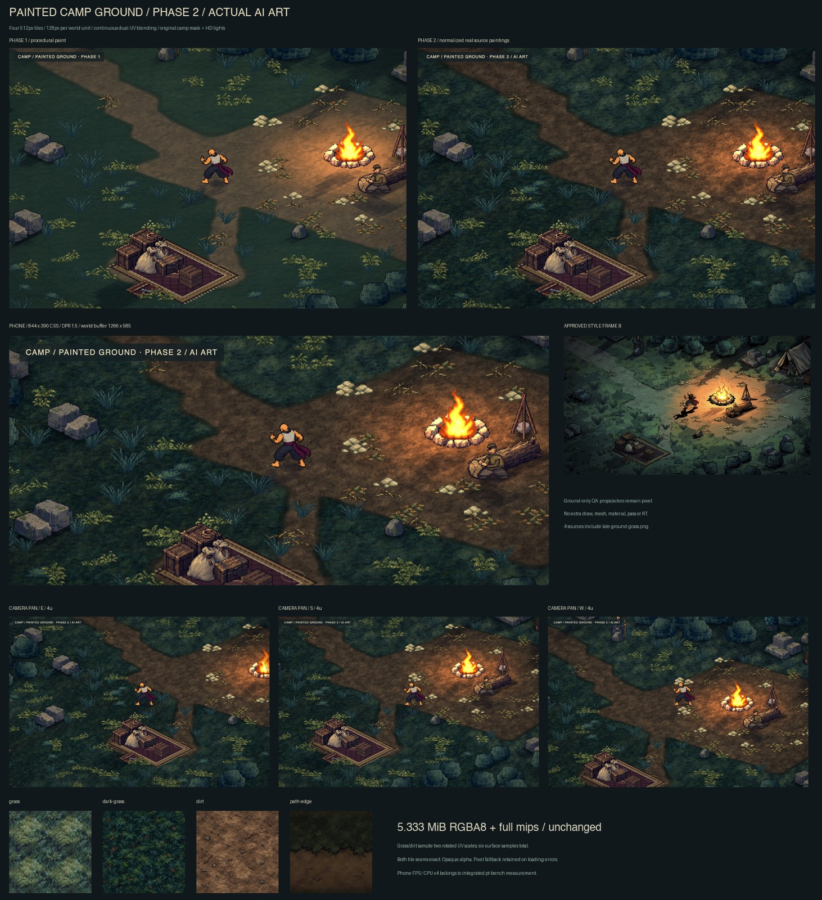

## Растения
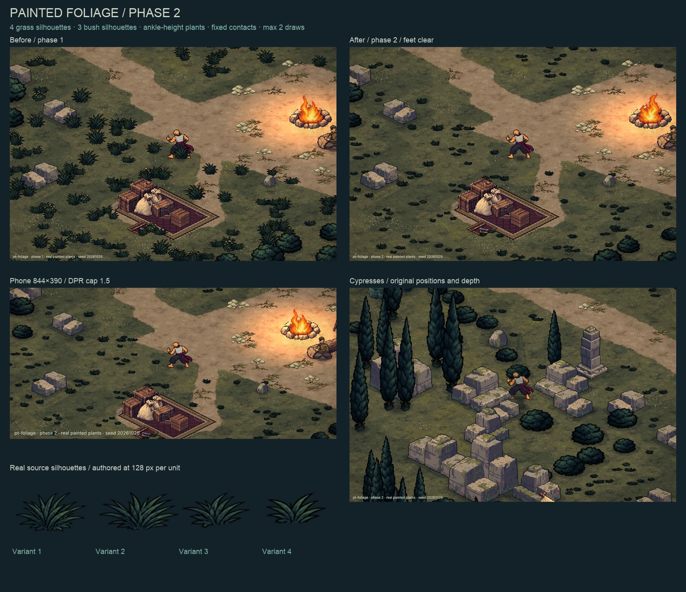

## Интерфейс
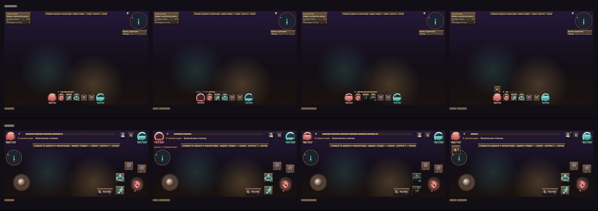
