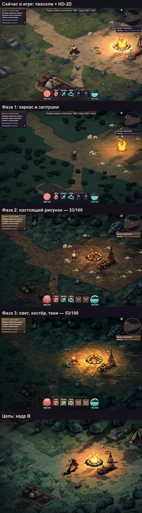
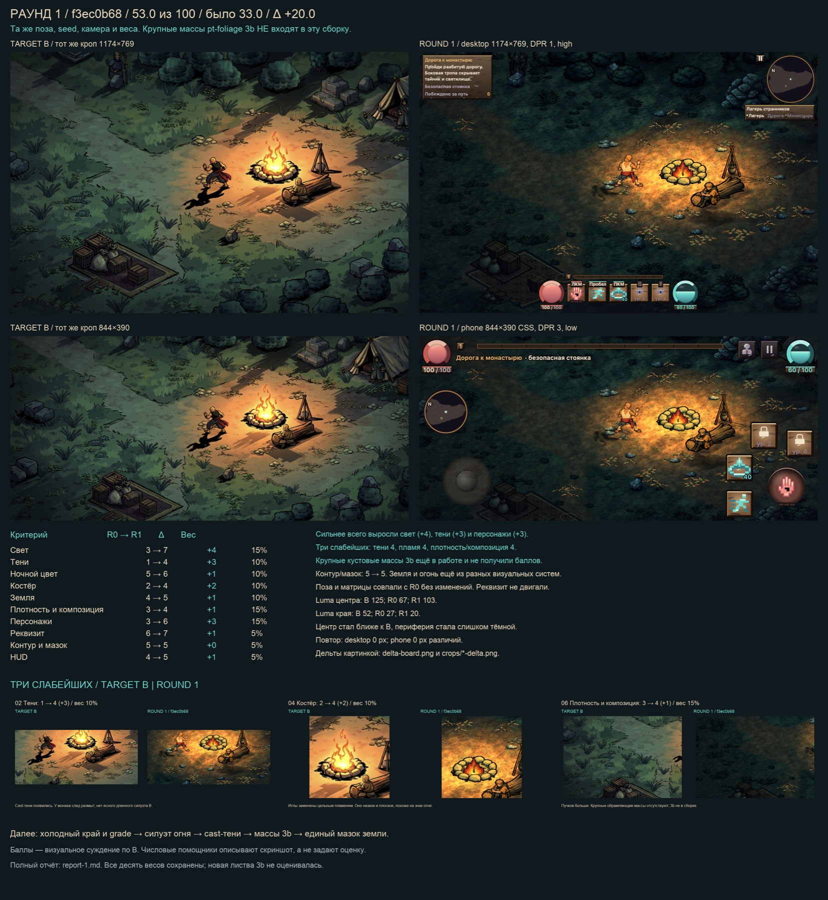
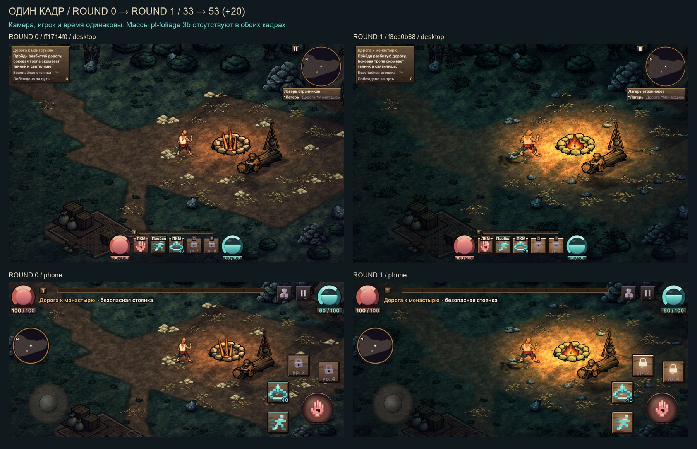
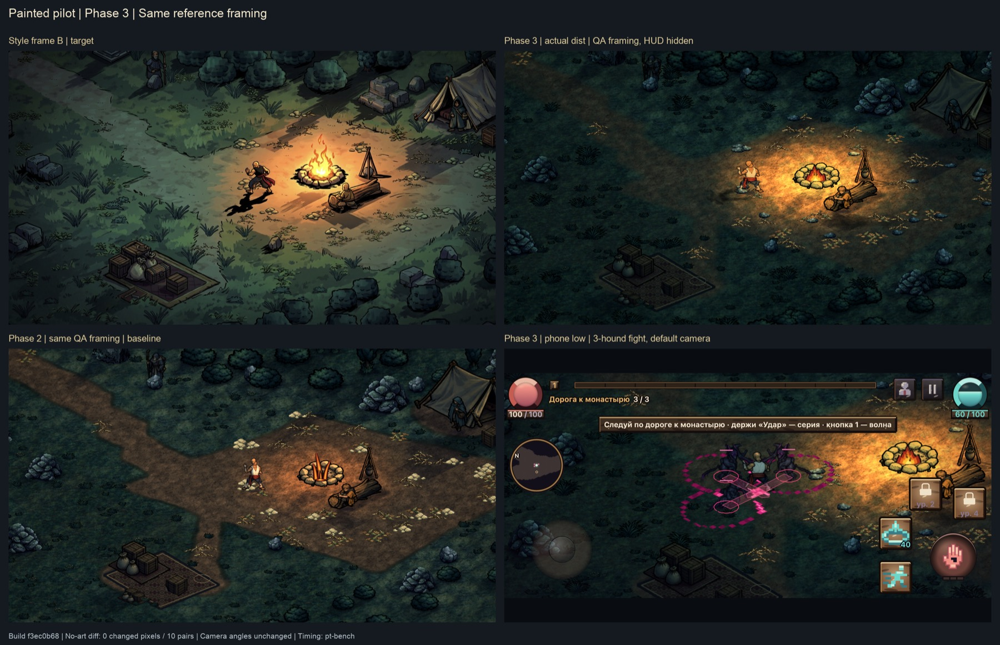
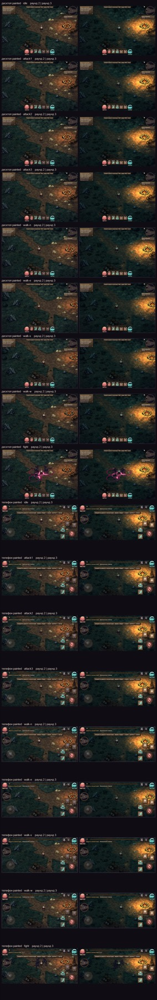
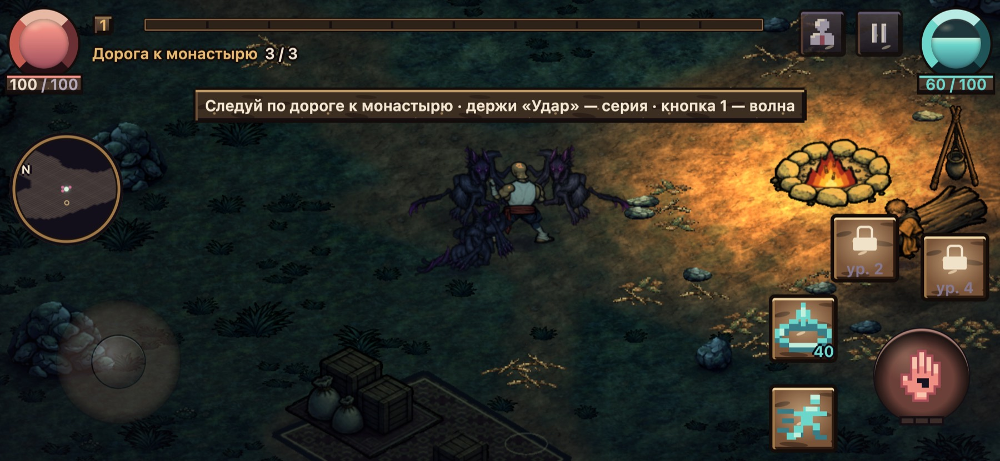

# Пилот «рисованное 2D»

## Прогресс одной лентой
Сверху вниз: игра сейчас → фаза 1 → фаза 2 → фаза 3 → цель. Фазы 2 и 3 сняты в одном кадре, подобранном под цель. Верхние два кадра — в обычной камере игры. Фаза 4 идёт.

Скриншоты пилота. Код пилота живёт отдельно и в игру не входит. Игра остаётся пиксельной с HD-2D, пока решение о стиле не принято.

## Оценка сходства с целью (агент-критик pt-judge)
Критик ставит кадр игры в ту же композицию, что и кадр-цель, и оценивает 10 пунктов по 10 баллов. Веса постоянные, поэтому оценки раундов можно сравнивать.

| Раунд | Сборка | Сходство |
|---|---|---:|
| 0 | фаза 2 (`ff1714f0`) | **33 / 100** |
| 1 | фаза 3 (`f3ec0b68`) | **53 / 100** (+20) |

Раунд 1: свет 3→7, тени 1→4, персонажи 3→6, костёр 2→4. Слабые места: тени, костёр и плотность — по 4/10. Край кадра стал слишком тёмным и синим. Пламя низкое и плоское. Крупных кустов по краям ещё нет.

Раунд 0:

Раунд 0, слабые места: тени 1/10, костёр 2/10, свет, плотность и персонажи по 3/10. Лучше всего — реквизит 6/10.

## Фаза 3 — общая сборка `f3ec0b68`
Цель фазы 3 — довести всю сцену до кадра-цели: свет, костёр, тени, земля, плотность.
Слева вверху — цель. Справа вверху — фаза 3 в том же кадре. Слева внизу — фаза 2 в том же кадре. Справа внизу — бой с тремя гончими на телефоне.
Сведено 12 патчей без конфликтов, 1539 тестов прошли. Крупные кусты по краям (фаза 3b) в эту сборку ещё не вошли.

### Фаза 2 → фаза 3 (QA, одинаковые кадры)

### Бой с тремя гончими на телефоне, фаза 3

### Доски отдельных агентов фазы 3

### Свет
Сверху — кадр-цель. Внизу слева — фаза 2, справа — фаза 3: тёплый круг у костра, холодная ночь вокруг. Новых проходов отрисовки нет. Костёр на этих кадрах ещё старый.

### Растения: плотность

### Костёр и эффекты — черновик
Пламя на 10 кадров, искры, дым, вспышки ударов. Агент ещё работает.

### Интерфейс
Кнопки умений без пиксельных вырезов, деревянные плашки.

### Скорость (сборка фазы 2)
Телефон в эмуляции, CPU ×4, уровень «низкий»: 120 FPS и у пикселей, и у рисованного стиля, кадров дольше 33 мс нет.

---

# Фаза 2

Сборка `ff1714f0`, 2026-10-25.

## Сборка пилота
Слева вверху — кадр-цель. Справа — фаза 1. Внизу — фаза 2: компьютер в покое и бой с тремя гончими на телефоне.

## Монах: все клипы
Покой, бег, три удара, рывок, ранение, смерть, волна. По 8 кадров на направление.

## Монах: размер
Рост как у пиксельного монаха: 1,9375 метра игры. Широкая боевая стойка.

## Гончая

## Предметы и NPC
Реквизит лагеря. Атлас 8 МБ вместо 16.

## Земля

## Растения

## Интерфейс

