# Стиль-срез v2 · лагерь

Перезапуск рисованного стиля. Один эталон — кадр B. Все листы сгенерированы в одной сессии с опорой на кадр B. Сначала макет кадра, потом игра.

## Макеты кадра
Макет A — нарисованный фон зоны + огонь + монах с тенью.

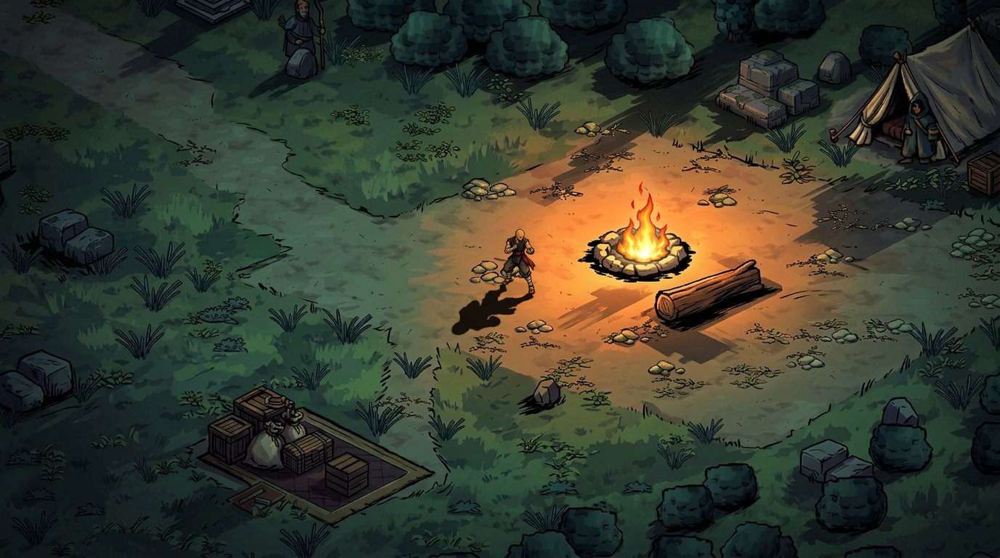

Макет B — только части, как в движке: тайлы земли и спрайты.

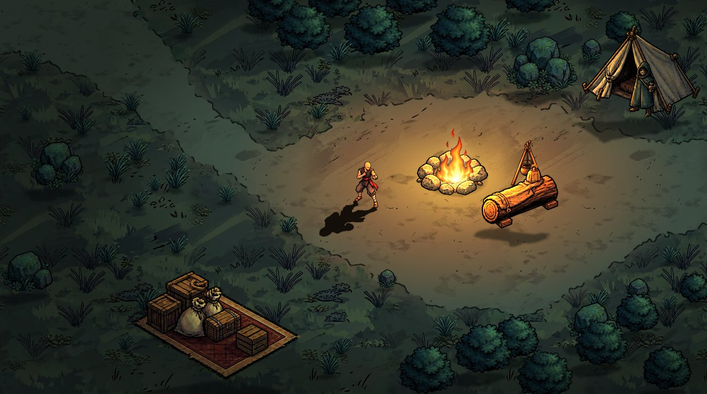

Сравнение с кадром B (слева B, справа макет; внизу увеличенные участки):

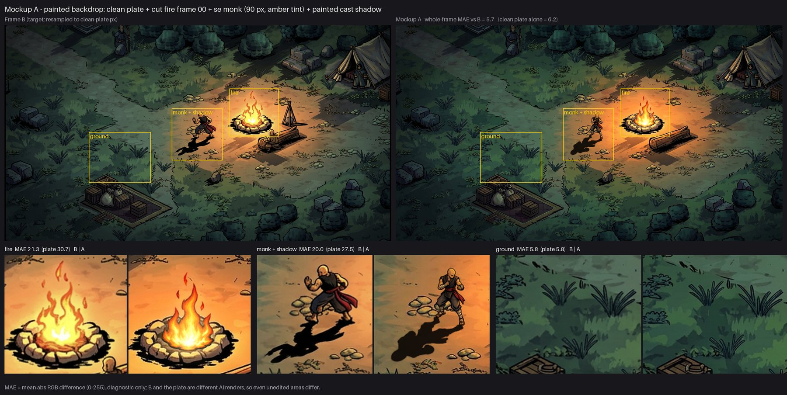

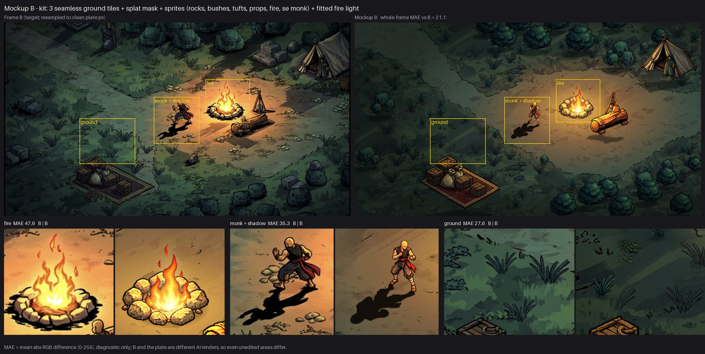

Огонь, 10 кадров по кругу:

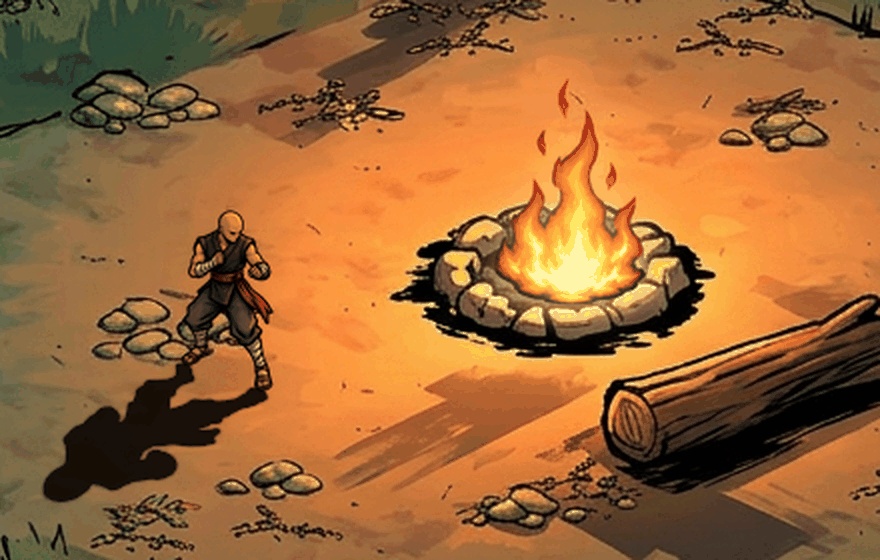

## Исходные листы
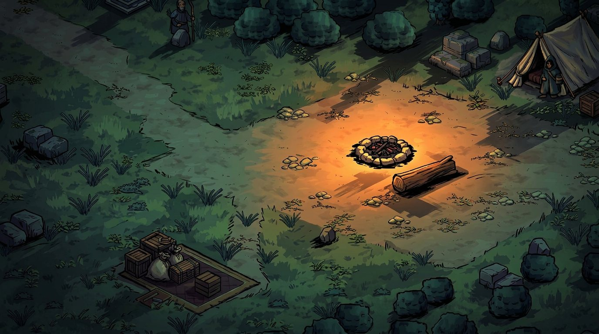
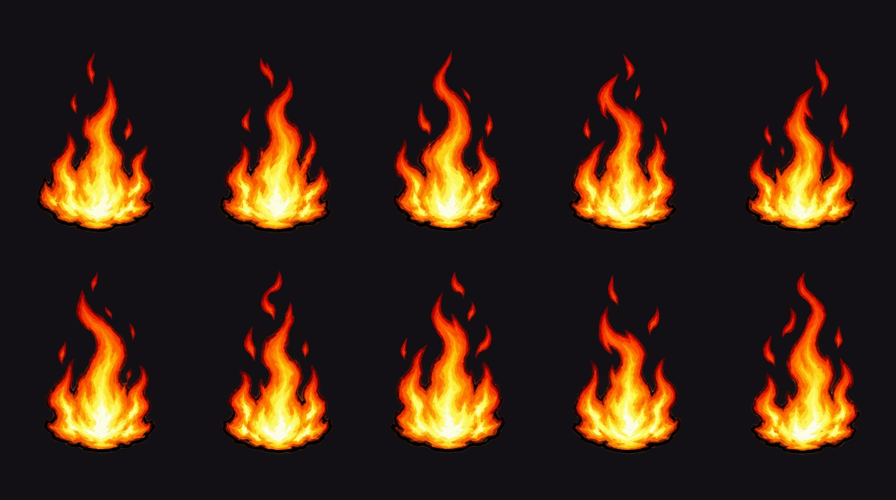
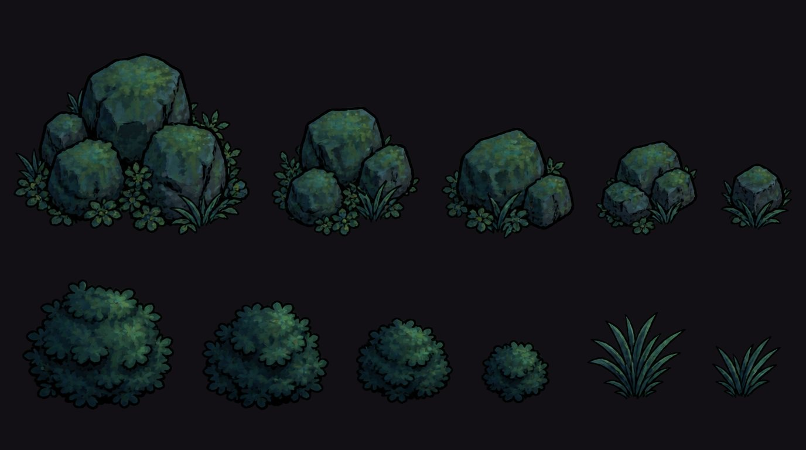
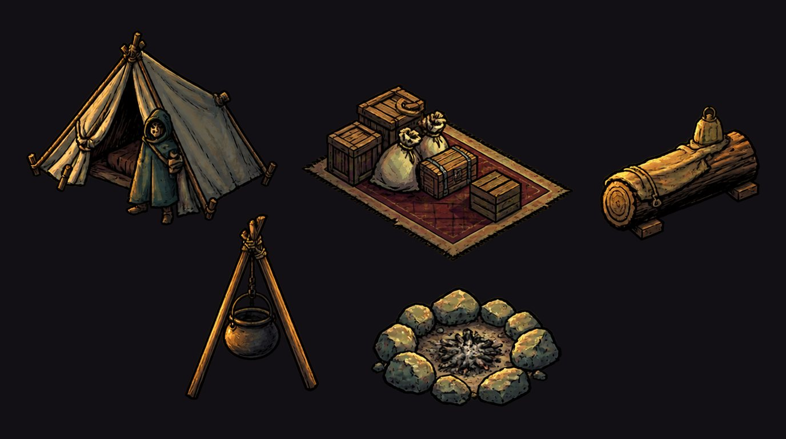
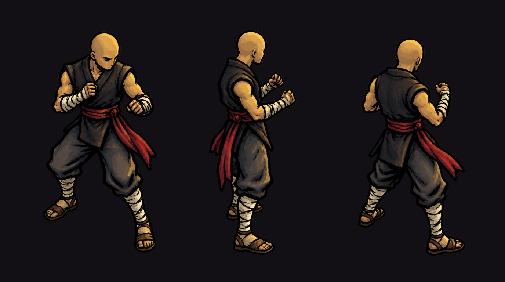
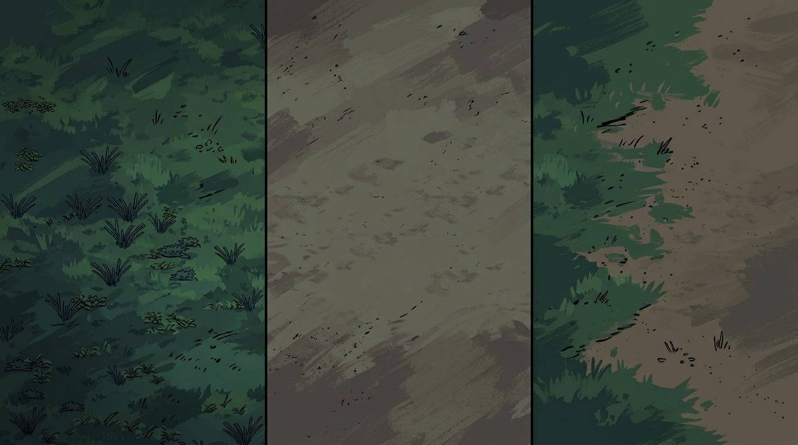

## Что ещё не так
- Обводка монаха тоньше, чем у остального: около 0.6 px против 2 px.
- Монах в кадре B крупнее по пропорциям: голова примерно в 1.6 раза больше.
- Тайлы земли повторяются каждые 384 px, а плавный стык двоит мазки.
- Край травы нарисован только в одной ориентации.

## Тест анимации монаха (готов)
Два клипа: стойка (1,17 с) и удар (0,58 с), 12 кадров в секунду.
Два способа: покадровый (6 ключевых поз от AI) и риг (17 деталей от AI на скелете).

Стойка, покадровая:

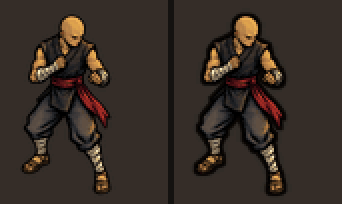

Стойка, риг (без обводки | с обводкой | коренастый с обводкой):

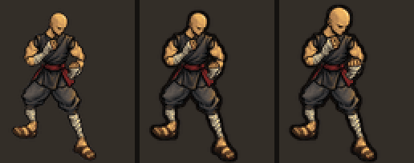

Удар, покадровый:

Удар, риг (без обводки | с обводкой | коренастый с обводкой):

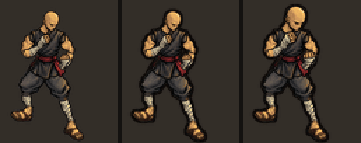

Удар в лагере, покадровый:

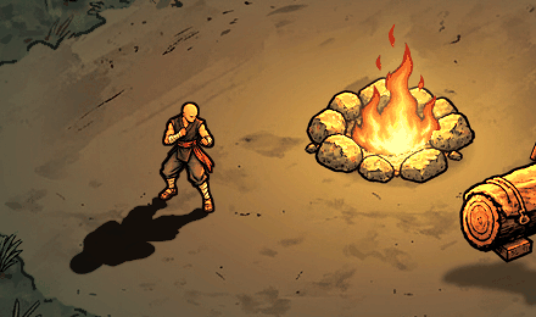

Удар в лагере, риг:

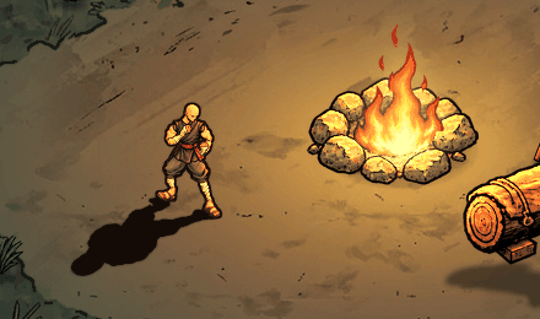

Все кадры на одной доске: [board.jpg](anim/board.jpg).

### Итог
- Отдельный кадр лучше у покадровой версии. Корпус разворачивается, штаны и пояс как в кадре B.
- Движение плавнее у рига. Покадровая стойка дёргается: смена позы 1 на позу 2 меняет 19 % силуэта.
- Новый клип у рига стоит минуты. Покадровой версии нужны новые позы от AI на каждый клип, направление и одежду.
- Обводка +1 px нужна обоим способам. Без неё линия монаха 0,6 px и теряется на земле.
- Рекомендация: риг, но детали надо перерисовать. Серые круги на суставах убрать, длину рук и ног и цвет подогнать к ключевым позам. Для скрута корпуса в ударе нужны 2–3 рисунка торса.
